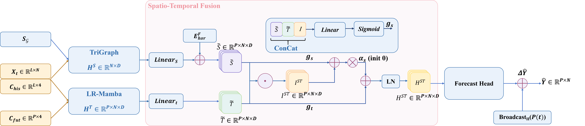

# PAST-GMamba

Official code repository for the manuscript:

**PAST-GMamba: Persistence-Anchored Parallel Spatio-Temporal Graph Mamba for Multi-Site Photovoltaic Power Forecasting**

The code will be made public after the paper is published. A bibliographic entry will be added at that time.

## Overall architecture



TriGraph and LR-Mamba run in parallel. Spatio-Temporal Fusion builds a lead-specific representation, and the Forecast Head adds its residual to the broadcast latest observation. In the code, the Forecast Head is the Prediction Head.

## Requirements

- Python 3.10, 3.11, or 3.12
- PyTorch 2.4 or newer, below 3.0
- A CUDA GPU for the official Mamba-2 backend. The pure PyTorch backend `torch_mamba2_ref` also runs on CPU.

Dependency files:

| File | Contents |
|---|---|
| `requirements.txt` | PyTorch, NumPy, pandas, PyYAML, einops, tqdm, TensorBoard, Matplotlib, psutil |
| `requirements-dev.txt` | `requirements.txt` plus pytest |
| `requirements-mamba.txt` | `requirements.txt` plus `mamba-ssm==2.2.5` and `causal-conv1d==1.5.2` |

## Environment

Create a clean environment and install the package in editable mode:

```bash
conda create -n past-gmamba python=3.11 -y
conda activate past-gmamba
pip install -r requirements.txt
pip install -e .
```

On a CUDA machine, install a PyTorch build that matches the driver before installing the rest of the requirements, then keep that build:

```bash
pip install torch --index-url https://download.pytorch.org/whl/cu124
pip install -r requirements.txt --upgrade-strategy only-if-needed
pip install -e .
```

Use the CUDA wheel URL published for the installed driver at [pytorch.org](https://pytorch.org/get-started/locally/).

The default backend is `torch_mamba2_ref`, a pure PyTorch Mamba-2 implementation. Linux hosts with a compatible CUDA toolkit can install the official fused backend:

```bash
pip install --no-build-isolation -r requirements-mamba.txt
```

Set `model.backend: official_mamba2` after that install. If the package is missing, training stops instead of substituting another network.

Install the test dependencies when running the unit tests:

```bash
pip install -r requirements-dev.txt
```
Train one run into an empty directory:

```bash
export PAST_GMAMBA_DATA_ROOT=/path/to/ca_dpv_data
export CUDA_VISIBLE_DEVICES=0
python -m past_gmamba.cli.train \
  --config configs/spatial_v2/onemonth_12_1_spatiotemporal.yaml \
  --data-root "$PAST_GMAMBA_DATA_ROOT" \
  --cache-dir artifacts/cache \
  --run-dir runs/onemonth_12_1_seed42 \
  --device cuda:0
```

`CUDA_VISIBLE_DEVICES` selects the physical GPU. Leave `training.device` at `cuda:0`; that index refers to the GPU visible inside the process. Training refuses to write into a directory that already contains files.

To change the prediction target or the temporal mixer, copy the YAML and edit `model`:

```yaml
model:
  prediction_target: absolute          # or persistence_residual
  temporal_mixer: mamba                # mamba, lstm, gru, or tcn
  tcn_kernel_size: 3                   # used only by tcn
```

`persistence_residual` adds the latest observation to a zero-initialized residual. `absolute` emits the normalized power directly. LSTM, GRU, and TCN replace only the temporal scan. The TriGraph stream is unchanged, and those three mixers do not load `mamba-ssm`.

A two-step check on the one-month data confirms that the environment can train:

```bash
python -m past_gmamba.cli.train \
  --config configs/smoke/spatiotemporal_graph_mamba.yaml \
  --data-root "$PAST_GMAMBA_DATA_ROOT" \
  --cache-dir artifacts/cache \
  --max-steps 2 \
  --run-dir runs/smoke_past_gmamba
```

## Evaluation

Evaluate the checkpoint selected on the validation split:

```bash
python -m past_gmamba.cli.evaluate \
  --run-dir runs/onemonth_12_1_seed42 \
  --checkpoint best.pt \
  --split test \
  --full-split \
  --output-dir runs/onemonth_12_1_seed42/evaluations/test \
  --data-root "$PAST_GMAMBA_DATA_ROOT"
```

The evaluation directory contains `metrics.json`, `pred.npy`, `true.npy`, `pred_pu.npy`, `true_pu.npy`, `last_observed_pu.npy`, and `origin_index.npy`. Megawatt arrays have shape `[samples, horizon, 238]`. Reported errors include all hours, active generation hours, individual forecast leads, and ramp error. Outputs are not clipped, and MAPE is not used.

## Verification

Check that the selected Mamba backend runs and returns finite gradients:

```bash
python -m past_gmamba.cli.check_env --backend torch_mamba2_ref --device cpu
```

On a CUDA machine with the official backend:

```bash
python -m past_gmamba.cli.check_env \
  --backend official_mamba2 \
  --device cuda:0 \
  --mamba-compute-dtype float32 \
  --no-amp
```

Run the unit tests:

```bash
pytest -q
```

After training finishes, check that `best.pt`, `last.pt`, `history.json`, and `training_summary.json` describe the same run:

```bash
python -m past_gmamba.cli.verify_run \
  --run-dir runs/onemonth_12_1_seed42
```

After evaluation, check array shapes, hashes, and sample identity:

```bash
python -m past_gmamba.cli.verify_evaluation \
  --run-dir runs/onemonth_12_1_seed42 \
  --evaluation-dir runs/onemonth_12_1_seed42/evaluations/test \
  --split test \
  --require-full-split
```
